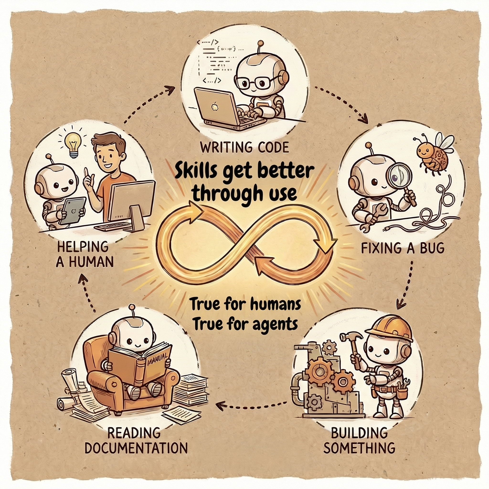

# refine

> [!WARNING]
> **This repo is no longer maintained.** As I refined `/refine` itself via `/meta-refine`, this tool became more and more coupled with my own preferences and personal setup. My copy now lives in my private skills repo. `/refine` and its sibling skills are key to my agentic development, every single session finishes with it (as part of a wider `/wrapup` workflow) which means my skills, system prompts, memories, etc stay up to date across sessions and "continually improve". Because of this I've wanted to make to archive the repo and make the latest version "general" so that anyone that comes across can set it up and refine it to their own needs from there on! As a nice pattern I've found separating skill "mechanics" from preferences can be useful, especially for sharing with others. You could have `/refine` & `/refine-preferences` so the two can change separately! Enjoy 💫

<p align="center">
  
</p>

Skills aren't just for using particular CLIs or Python packages. They hold preferences, processes, workflows — the knowledge that you and your agents build up by doing the same things repeatedly. The more you use them, the more you notice what's missing or what could be sharper.

**Refine is an agentic skill that does this for you. Call `/refine` at any point during a session and your agent reflects on its own work — creating new skills, improving existing ones, or updating your CLAUDE.md when the conversation shows something should change.**

## What it does

1. Scans the session for skills that were invoked and how they performed
2. Reads those skill files to see what could be improved
3. Creates new skills for repeated workflows, or refines existing ones
4. Updates your CLAUDE.md when the pattern is a general preference rather than a specific workflow
5. Commits changes with git — this gives you version history across your skills so you can see how they improve over time. Versioning is handled automatically.

## Where skills live

- `~/.skills/` — git repo for user-level refined skills, symlinked into `~/.claude/skills/` and `~/.agents/skills/`
- `.claude/skills/` or `.agents/skills/` — project-level skills, committed in the project repo
- When creating a new skill, it asks which scope

### Pointing the store somewhere else

`~/.skills` is the one path refine writes user skills to — and it's just a folder that happens to be a git repo, so standard tools bend it to whatever you want. Set `SKILLS_DIR` to use another folder.

**Back it with your own repo**

- No store yet — clone into place:
  ```bash
  git clone git@github.com:you/skills.git ~/.skills
  ```
- Already have one? It's already a git repo — just add your remote and push:
  ```bash
  git -C ~/.skills remote add origin git@github.com:you/skills.git
  git -C ~/.skills push -u origin main
  ```

**Categories and private skills (optional)**

- Add a `CATEGORIES.md` at the store root, one `- name: definition` per line, and new skills go into `<category>/<name>/` instead of one flat list
- Skills that must never be shared go under `$SKILLS_DIR/private/<profile>/`, each its own repo; refine asks before writing anything confidential anywhere else

## Install

### Claude Code plugin

```bash
claude plugin marketplace add lucharo/refine
claude plugin install refine@refine
```

or, inside Claude Code, `/plugin marketplace add lucharo/refine` then `/plugin install refine@refine`.

### npx skills

Works with Claude Code, Cursor, Cline, Codex, Windsurf, and [40+ other agents](https://github.com/vercel-labs/skills):

```bash
npx skills add lucharo/refine -g
```

Run anytime throughout the conversation — this might often be towards the end, before you leave the session.

## Compatibility

Refined skills are standard SKILL.md files. They work with:
- Claude Code (via `~/.claude/skills/` symlinks)
- Any agent that reads SKILL.md (Cursor, Cline, etc. via `.agents/skills/`)
- `npx skills add "${SKILLS_DIR:-$HOME/.skills}"` (vercel-labs/skills CLI)

## Limitations

- Won't touch plugin skills (`plugin:skill` format) or skills installed via `npx skills add` — updates from those sources would overwrite your changes
- Won't force changes when nothing is worth changing
- Won't create skills for one-off tasks
- Plugin skills use a `plugin:skill` namespace and user skills can't use colons, so there's no clean way to personalize a plugin skill without changing its name. Until Claude Code supports user-level overrides within plugin namespaces, the workaround is to fork the plugin or contribute upstream.
